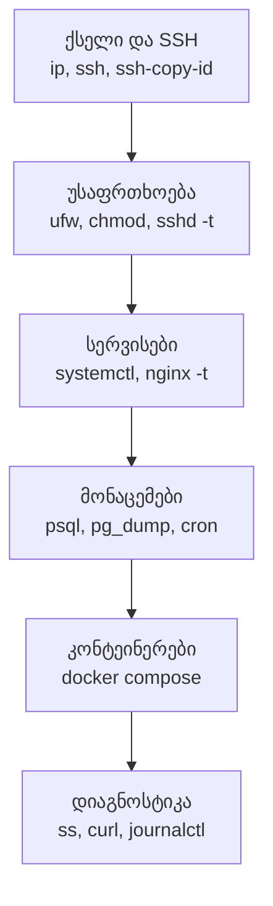

# ბრძანებების ცნობარი

ყველა მნიშვნელოვანი ბრძანება, რომელიც Task 1-17-ში გამოვიყენეთ: **რას აკეთებს** და **რატომ გვჭირდებოდა**. ბრძანებები დაჯგუფებულია თემატურად. ბოლოში მოცემულია დიაგნოსტიკის სქემა: სიმპტომიდან პირველ ბრძანებამდე.

## 1. ქსელი და დაკავშირება

| ბრძანება | რას აკეთებს | რატომ |
|----------|-------------|-------|
| `ip -4 a show enp0s8` | აჩვენებს მხოლოდ IPv4 მისამართს ერთი ინტერფეისისთვის | ვამოწმებთ, რომ Host-Only ინტერფეისმა სტატიკური `192.168.56.10` მიიღო |
| `ip a` | ყველა ინტერფეისი და მისამართი | პირველი ნაბიჯი ქსელის პრობლემისას: რომელი ინტერფეისია ჩართული |
| `VBoxManage list hostonlyifs` | ჰოსტზე Host-Only ქსელების სია | გავიგეთ, რომ `vboxnet0` არის `192.168.56.1/24` |
| `sudo netplan try` / `sudo netplan apply` | `try` დროებით იყენებს კონფიგს და თუ არ დაადასტურე, უკან აბრუნებს; `apply` მუდმივად | `try` გვიცავს გამოკეტვისგან, თუ YAML არასწორია |
| `ping 192.168.56.10` | ამოწმებს ხელმისაწვდომობას | ჰოსტი ხედავს თუ არა VM-ს |
| `ssh k@192.168.56.10` | დაკავშირება VM-თან | ყოველდღიური წვდომა |
| `ssh -v k@...` | დეტალური ლოგი | აჩვენებს, რომელ key-ს ცდის და რატომ ითხოვს პაროლს |
| `ssh-keygen -t ed25519 -C "k@k-M4700"` | თანამედროვე key-ის წყვილის შექმნა | პაროლის გარეშე უსაფრთხო შესვლისთვის |
| `ssh-copy-id k@192.168.56.10` | public key-ს სერვერის `authorized_keys`-ში წერს | ხელით კოპირების შეცდომების გარეშე |

## 2. უსაფრთხოება და უფლებები

| ბრძანება | რას აკეთებს | რატომ |
|----------|-------------|-------|
| `sudo sshd -t` | SSH კონფიგის სინტაქსის შემოწმება რესტარტის გარეშე | შეცდომიანი კონფიგით რესტარტი გამოგკეტავს სერვერიდან |
| `sudo systemctl restart ssh` | SSH-ის გადატვირთვა | ახალი წესები (`PasswordAuthentication no`) ამოქმედდეს |
| `chmod 700 ~/.ssh` | მხოლოდ მფლობელს აძლევს წვდომას საქაღალდეზე | SSH უარს ამბობს key-ზე, თუ უფლებები ზედმეტად ღიაა |
| `chmod 600 ფაილი` | მხოლოდ მფლობელი კითხულობს/წერს | `authorized_keys`, `~/.pgpass`, `selfsigned.key` |
| `sudo ufw allow 22` / `80` / `443` | ფაირვოლის წესი | მხოლოდ საჭირო პორტები უნდა იყოს ღია |
| `sudo ufw status numbered` | წესები ნომრებით | წესის წასაშლელად: `sudo ufw delete N` |
| `sudo ufw status verbose` | ნაგულისხმევი პოლიტიკა (`deny incoming`) | ვამოწმებთ, რომ დახურულია ყველაფერი, რაც არ გვინდა |

!!! warning "Docker და UFW"
    Docker-ის გამოქვეყნებული პორტი UFW-ს გვერდს უვლის. ერთადერთი სწორი გზა `127.0.0.1:8080:80` მიბმაა (Task 15/16).

## 3. სერვისები და Nginx

| ბრძანება | რას აკეთებს | რატომ |
|----------|-------------|-------|
| `systemctl status nginx` | სერვისის მდგომარეობა და ბოლო ლოგები | ჩართულია თუ არა და რა შეცდომა დაიწერა |
| `sudo systemctl enable --now nginx` | ჩართვა ახლავე და ჩატვირთვისას | სერვერის რესტარტის შემდეგაც იმუშავოს |
| `sudo nginx -t` | კონფიგის სინტაქსის შემოწმება | **ყოველთვის** reload-მდე: შეცდომა მუშა საიტს არ დაგვიზიანებს |
| `sudo systemctl reload nginx` | კონფიგის ხელახლა წაკითხვა კავშირების გაწყვეტის გარეშე | restart-ისგან განსხვავებით მომხმარებლებს არ აწყვეტს |
| `sudo nginx -T` | აჩვენებს **ამოქმედებულ სრულ** კონფიგს ყველა ფაილიდან | გამოავლინა, რომ `app.test`-ის ბლოკი სინამდვილეში არ იყო ჩართული |
| `ln -s sites-available/X sites-enabled/` | საიტის ჩართვა | `sites-available` არის საწყობი, `sites-enabled` არის აქტიური |
| <code>sudo ss -tlnp &#124; grep :443</code> | ვინ უსმენს პორტს | `nginx -t` OK-ს გვეუბნება, მაგრამ ეს ამოწმებს, რომ პორტი რეალურად ღიაა |
| `curl -I http://localhost/` | მხოლოდ HTTP სათაურები | სწრაფი შემოწმება: სტატუსი, ზომა, სერვერი |
| `curl -I -H "Host: app.test" http://localhost/` | ხელით Host სათაური | virtual host-ის ტესტი DNS/hosts-ის გარეშე |
| <code>curl -s URL &#124; grep -i "&lt;title&gt;"</code> | გვერდის სათაურს იღებს | განასხვავებს ორ საიტს, როცა `200 OK` ორივეზე ერთია |
| `curl -kI https://localhost/` | `-k` სერტიფიკატის ნდობას არ ამოწმებს | self-signed სერტიფიკატთან მუშაობისას |
| <code>curl -vk https://... 2&gt;&amp;1 &#124; grep ...</code> | TLS დეტალები (ვერსია, subject, ვადა) | `2>&1` აუცილებელია, რადგან `-v` stderr-ზე წერს |

!!! tip "ჩვენი გაკვეთილი"
    `curl -I` სტატუსს გვიჩვენებდა, მაგრამ ორ სხვადასხვა საიტს ვერ განასხვავებდა. `Content-Length` და `<title>` გვითხრა სიმართლე. რთულ შემთხვევაში `nginx -T` ამოქმედებულ ფაილს აჩვენებს და არა იმას, რასაც ვფიქრობთ, რომ ვწერთ.

## 4. ფაილების მართვა (სწრაფი ცვლილებები)

| ბრძანება | რას აკეთებს | რატომ |
|----------|-------------|-------|
| <code>sed -i 's&#124;"8080:80"&#124;"127.0.0.1:8080:80"&#124;' ფაილი</code> | ტექსტის ჩანაცვლება ფაილში | nano-ში ძებნის გარეშე ერთი ბრძანებით; <code>&#124;</code> გამყოფია, რომ `/` არ დაგვჭირდეს |
| `sudo sed -i '44,$d' ფაილი` | 44-ე ხაზიდან ბოლომდე წაშლა | ფაილში შემთხვევით მოხვედრილი ნარჩენების მოსაშორებლად |
| `cat -n ფაილი` | ხაზების ნომრებით | შეცდომის ხაზი (`mgawm:44`) უშუალოდ პოულობ |
| `grep -n 'ტექსტი' ფაილი` | ძებნა ხაზის ნომრით | ვამოწმებთ, რომ ცვლილება ჩაიწერა |
| `sudo tee ფაილი > /dev/null <<'EOF' ... EOF` | ტექსტის ჩაწერა root-ის ფაილში | `sudo` არ მუშაობს `>`-ზე, `tee` კი root-ით წერს; `'EOF'` ბრჭყალებით `$` ცვლადებს არ ანაცვლებს |

!!! warning "ხშირი შეცდომა"
    `sudo tee ... <<EOF` ტერმინალში უნდა გაეშვას და **არა** nano-ში. nano-ში მხოლოდ ფაილის შიგთავსი იწერება, წინააღმდეგ შემთხვევაში ბრძანება ტექსტად მოხვდება ფაილში (`unknown directive "sudo"`).

### Tailscale (კერძო ქსელი მოწყობილობებს შორის)

| ბრძანება | რას აკეთებს | რატომ |
|----------|-------------|-------|
| <code>curl -fsSL https://tailscale.com/install.sh &#124; sh</code> | აყენებს Tailscale-ს | VM ხდება tailnet-ის წევრი |
| `sudo tailscale up` | აკავშირებს ანგარიშთან (ბმულით ავტორიზაცია) | ტელეფონი VM-ს პირდაპირ ხედავს |
| `tailscale ip -4` | მოწყობილობის `100.x.y.z` მისამართი | ამ IP-ს ვუთითებთ Nginx-ის `server_name`-ში |

## 5. PostgreSQL, backup და cron

| ბრძანება | რას აკეთებს | რატომ |
|----------|-------------|-------|
| `sudo -u postgres psql` | შესვლა DB-ში postgres-ის სახით | პირველადი დაყენება, როლებისა და DB-ს შექმნა |
| `\du`, `\l`, `\dt` | როლები, ბაზები, ცხრილები | psql-ის შიდა ბრძანებები: ვამოწმებთ, რა შევქმენით |
| `psql -h localhost -U appuser app_db` | შესვლა აპლიკაციის იუზერით | ვამოწმებთ პაროლით ავტორიზაციას |
| `~/.pgpass` (`chmod 600`) | პაროლის შენახვა ფაილში | სკრიპტი პაროლს არ ითხოვს და ბრძანების ხაზში არ ჩანს |
| `pg_dump -w` | ბაზის ასლი, `-w` პაროლს არასოდეს ითხოვს | cron-ს არავინ ჰყავს პაროლის ჩასაწერად, ამიტომ `.pgpass` გვჭირდება |
| `tar -czf` / `tar -tzf` | დაარქივება / შიგთავსის ნახვა | backup-ის შეკუმშვა და შემოწმება აღდგენამდე |
| `crontab -e` / `crontab -l` | cron ამოცანების რედაქტირება / ნახვა | ავტომატური backup |
| `0 3 * * * ...` | ყოველდღე 03:00-ზე | წუთი საათი დღე თვე კვირის-დღე; ღამით დატვირთვა დაბალია |
| `>> log 2>&1` | stdout და stderr ლოგში ემატება | cron-ის შეცდომა თორემ უხილავია |
| `timedatectl` | დროის სარტყელი | cron სისტემის დროით მუშაობს (`Asia/Tbilisi`) |
| `flock -n lock ბრძანება` | ერთდროულ გაშვებას ბლოკავს | auto-deploy სკრიპტი ორჯერ არ გაეშვება |

## 6. ლოგები და მონიტორინგი

| ბრძანება | რას აკეთებს | რატომ |
|----------|-------------|-------|
| `journalctl -u ssh` | SSH სერვისის ლოგები | ახალ Ubuntu-ზე პროცესი `sshd-session`-ია, ამიტომ `_COMM=sshd` ცარიელს აბრუნებს |
| `journalctl _COMM=sudo` | ყველა `sudo` გამოყენება | აუდიტი: ვინ რა გაუშვა |
| `journalctl -u nginx -n 50 --no-pager` | ბოლო 50 ხაზი | სერვისის ჩავარდნის მიზეზი |
| `sudo tail -f /var/log/auth.log` | ლოგის ცოცხალი ნახვა | შესვლის მცდელობები რეალურ დროში |
| `last -n 10` | ბოლო შესვლები | ვინ და საიდან შემოვიდა (`wtmpdb`-ზე დაფუძნებული) |
| `grep "Failed password" /var/log/auth.log` | წარუმატებელი მცდელობები | brute-force-ის ნიშანი |

## 7. Docker და Compose

| ბრძანება | რას აკეთებს | რატომ |
|----------|-------------|-------|
| `docker compose up -d` | აშენებს/ჩართავს ყველა სერვისს ფონზე | ერთი ბრძანება მთელი სტეკისთვის; ცვლილებისას მხოლოდ შეცვლილს ხელახლა ქმნის |
| `docker compose ps` | კონტეინერები, სტატუსი და პორტები | `127.0.0.1:8080->80/tcp` ამოწმებს, რომ პორტი მხოლოდ ლოკალურია |
| `docker compose logs -f web` | სერვისის ლოგები | კონტეინერი რატომ ვარდება |
| `docker compose down` | ჩამოხსნა, მონაცემები (volume) რჩება | უსაფრთხო გაჩერება |
| `docker compose down -v` | ჩამოხსნა + volume-ის წაშლა | **წაშლის DB-ს**: გამოვიყენეთ პაროლის პრობლემის გადასაჭრელად, როცა მონაცემები არ გვენანებოდა |
| `docker compose exec db psql -U appuser` | ბრძანება მუშა კონტეინერში | DB-ში შესვლა პორტის გამოქვეყნების გარეშე |
| `docker compose -f ფაილი up -d` | კონკრეტული compose ფაილი | როცა `~/docker-app`-ში არ ხარ (`no configuration file provided`) |
| `docker ps` / `docker images` | კონტეინერები / იმიჯები | ზოგადი მდგომარეობა |
| `healthcheck` + `depends_on: service_healthy` | web ელოდება DB-ს მზადყოფნას | DB-ს ჩართვა არ ნიშნავს, რომ მზადაა |

!!! info "Postgres-ის პაროლი"
    `POSTGRES_PASSWORD` მხოლოდ volume-ის პირველად ინიციალიზაციაზე მოქმედებს. ცვლილების შემდეგ ან `ALTER USER`, ან `down -v` (მონაცემები იკარგება).

## 8. SSL / TLS

| ბრძანება | რას აკეთებს | რატომ |
|----------|-------------|-------|
| `openssl req -x509 -nodes -days 365 -newkey rsa:2048 ...` | საკუთარი სერტიფიკატი და გასაღები ერთი ბრძანებით | ლოკალური HTTPS ტესტი, CA-ს გარეშე |
| `-addext "subjectAltName=IP:...,DNS:..."` | IP და hostname სერტიფიკატში | browser-ები `CN`-ს მხოლოდ აღარ ეყრდნობიან |
| `openssl x509 -in selfsigned.crt -noout -dates -subject` | სერტიფიკატის ვადა და subject | ვამოწმებთ, რა გავცეთ |
| `ssl_protocols TLSv1.2 TLSv1.3;` | Nginx-ში ძველი პროტოკოლების გამორთვა | SSLv3 და TLS 1.0/1.1 დაუცველია |

## 9. Git და დოკუმენტაცია

| ბრძანება | რას აკეთებს | რატომ |
|----------|-------------|-------|
| `git fetch` | იღებს ცვლილებებს ფაილების შეცვლის გარეშე | auto-deploy-ში ჯერ ვამოწმებთ, არის თუ არა სიახლე |
| `git reset --hard origin/main` | ლოკალურს რეპოსთან ზუსტად ათანაბრებს | სერვერზე ხელით ცვლილებები არ უნდა დარჩეს (merge-ის კონფლიქტი აღარ იქნება) |
| `git -c user.name=... -c user.email=... commit` | ავტორი მხოლოდ ამ ბრძანებისთვის | გლობალურ კონფიგს არ ვცვლით |
| `mkdocs serve -a 127.0.0.1:8001` | ლოკალური გადახედვა | გამოქვეყნებამდე ვამოწმებთ დიაგრამებს |
| `mkdocs gh-deploy --force` | აგებს და `gh-pages`-ზე ტვირთავს | GitHub Actions workflow ამას თავისით აკეთებს push-ზე |

## ხშირი დიაგნოსტიკა: სიმპტომი → პირველი ბრძანება

| სიმპტომი | პირველი ბრძანება |
|----------|------------------|
| საიტი არ იხსნება | `curl -I localhost` VM-ში, შემდეგ <code>sudo ss -tlnp &#124; grep :80</code> |
| 443 არ მუშაობს | <code>sudo ss -tlnp &#124; grep :443</code>, შემდეგ <code>sudo nginx -T &#124; grep listen</code> |
| `nginx -t` ჩავარდა | შეცდომის ხაზი, შემდეგ `cat -n` იმ ფაილზე |
| არასწორი საიტი ჩანს | <code>curl -s ... &#124; grep -i "&lt;title&gt;"</code> და <code>sudo nginx -T &#124; grep server_name</code> |
| SSH პაროლს ითხოვს | `ssh -v`, შემდეგ `ls -ld ~/.ssh` და `ls -l ~/.ssh/authorized_keys` |
| კონტეინერი ვარდება | `docker compose ps`, შემდეგ `docker compose logs სერვისი` |
| cron არ მუშაობს | `crontab -l`, შემდეგ cron-ის ლოგი (`>> ... 2>&1`) |
| პორტი გარედან ჩანს, არ უნდა | `sudo ss -tlnp` (მისამართი `0.0.0.0` თუ `127.0.0.1`) |
