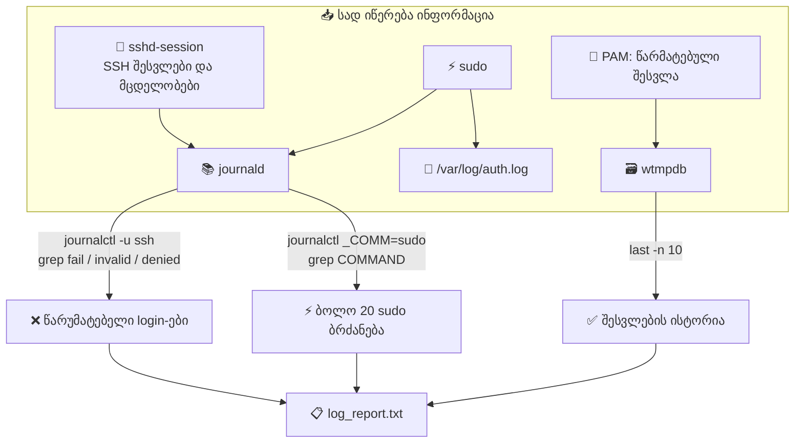

Task 13 — Log Monitoring

```bash
k@devserver:~$ sudo grep -i "failed" /var/log/auth.log | tail -50
```

sudo 👉 ნიშნავს: გაუშვი root-ის უფლებით

```console
/var/log/auth.log
```
ხშირად მხოლოდ root-ს აქვს წვდომა log ფაილზე, ამიტომ sudo საჭიროა.

```console
grep -i "failed"
```
👉 grep = ტექსტში ძებნა <br>
👉 "failed" = რასაც ეძებ <br>
👉 -i = case-insensitive (დიდი/პატარა ასო არ აქვს მნიშვნელობა) <br>

ანუ ეს მოძებნის:

- failed
- Failed
- FAILED
- FaIlEd
ყველა ასეთ ჩანაწერს.

```console
/var/log/auth.log
```

👉 ეს არის ავტორიზაციის ლოგი

აქ ინახება:

- SSH login-ები

- sudo გამოყენება

- Failed login მცდელობები

- root access

!!! danger
    ძალიან მნიშვნელოვანი ფაილია უსაფრთხოებისთვის 🔐

## Pipe

| (pipe)
```console
|
```

👉 ეწოდება pipe

ნიშნავს:

მარცხენა ბრძანების შედეგი გადაეცეს მარჯვენას

ანუ:
```console
grep შედეგი → tail იღებს
```

## tail

tail -50
```console
tail -50
```

👉 აჩვენებს ბოლო 50 ხაზს

ანუ არ გაჩვენებს ყველაფერს (შეიძლება ათასები იყოს), მხოლოდ ბოლო 50-ს.


მთლიანობაში რას აკეთებს?

ეს ბრძანება ნიშნავს:

🔍 იპოვე auth.log-ში ყველა სტრიქონი სადაც წერია "failed" <br>
📋 აიღე მათგან ბოლო 50 <br>
👑 sudo-თ (root უფლებით) <br>

ანუ:

👉 გაჩვენებს ბოლო 50 წარუმატებელ login / auth მცდელობას.

## გაშვების შედეგი
```console
2026-02-10T18:22:33.658001+00:00 
devserver sudo:        k : TTY=pts/0 ; PWD=/home/k ; USER=root ; COMMAND=/usr/bin/grep -i failed /var/log/auth.log
k@devserver:~$
```
ეს ნიშნავს:

👉 შენ თვითონ გაუშვი sudo grep <br>
👉 და ეს ფაქტი ჩაიწერა auth.log-ში <br>

ანუ ლოგში იპოვა საკუთარი ბრძანება 😄 <br>

ესეც სწორია — sudo ყოველთვის log - ში იწერება. <br>


თუ ცარიელია (ახალი სერვერია, ბევრი მცდელობა არ ყოფილა), ალტერნატივა:

```bash
sudo grep -iE "failed|invalid user|authentication failure" /var/log/auth.log | tail -50
```

```console
2026-02-10T18:22:33.658001+00:00 devserver sudo:        k : TTY=pts/0 ; PWD=/home/k ; USER=root ; COMMAND=/usr/bin/grep -i failed /var/log/auth.log
2026-02-10T18:22:47.469729+00:00 devserver sudo:        k : TTY=pts/0 ; PWD=/home/k ; USER=root ; COMMAND=/usr/bin/grep -iE 'failed|invalid user|authentication failure' /var/log/auth.log
k@devserver:~$
```


## sudo command
ბოლო 20 Sudo Command:
```{console hl_lines="1"}
sudo grep "sudo:" /var/log/auth.log | grep "COMMAND" | tail -20
2026-02-10T17:13:59.685114+00:00 devserver sudo:        k : TTY=pts/1 ; PWD=/home/k ; USER=root ; COMMAND=/usr/bin/systemctl status nginx
2026-02-10T17:14:29.948587+00:00 devserver sudo:        k : TTY=pts/1 ; PWD=/home/k ; USER=root ; COMMAND=/usr/sbin/ufw status
2026-02-10T17:14:58.594500+00:00 devserver sudo:        k : TTY=pts/1 ; PWD=/home/k ; USER=root ; COMMAND=/usr/sbin/ufw allow 'Nginx HTTP'
2026-02-10T17:15:03.038327+00:00 devserver sudo:        k : TTY=pts/1 ; PWD=/home/k ; USER=root ; COMMAND=/usr/sbin/ufw status
2026-02-10T17:25:59.218241+00:00 devserver sudo:        k : TTY=pts/0 ; PWD=/home/k ; USER=root ; COMMAND=/usr/bin/nano /var/www/html/index.html
2026-02-10T17:27:23.318108+00:00 devserver sudo:        k : TTY=pts/0 ; PWD=/home/k ; USER=root ; COMMAND=/usr/bin/chown www-data:www-data /var/www/html/index.html
2026-02-10T17:27:27.489504+00:00 devserver sudo:        k : TTY=pts/0 ; PWD=/home/k ; USER=root ; COMMAND=/usr/bin/chmod 644 /var/www/html/index.html
2026-02-10T17:27:33.522669+00:00 devserver sudo:        k : TTY=pts/0 ; PWD=/home/k ; USER=root ; COMMAND=/usr/bin/systemctl restart nginx
2026-02-10T17:31:21.578612+00:00 devserver sudo:        k : TTY=pts/0 ; PWD=/home/k ; USER=root ; COMMAND=/usr/bin/apt update
2026-02-10T17:31:33.136576+00:00 devserver sudo:        k : TTY=pts/0 ; PWD=/home/k ; USER=root ; COMMAND=/usr/bin/apt install postgresql postgresql-contrib -y
2026-02-10T17:33:51.098655+00:00 devserver sudo:        k : TTY=pts/0 ; PWD=/home/k ; USER=root ; COMMAND=/usr/bin/systemctl status postgresql
2026-02-10T17:34:19.371906+00:00 devserver sudo:        k : TTY=pts/0 ; PWD=/home/k ; USER=postgres ; COMMAND=/usr/bin/psql
2026-02-10T17:38:06.226756+00:00 devserver sudo:        k : TTY=pts/0 ; PWD=/home/k ; USER=root ; COMMAND=/usr/bin/systemctl restart postgresql
2026-02-10T18:14:32.286438+00:00 devserver sudo:        k : TTY=pts/0 ; PWD=/home/k ; USER=root ; COMMAND=/usr/bin/systemctl status cron
2026-02-10T18:22:33.658001+00:00 devserver sudo:        k : TTY=pts/0 ; PWD=/home/k ; USER=root ; COMMAND=/usr/bin/grep -i failed /var/log/auth.log
2026-02-10T18:22:47.469729+00:00 devserver sudo:        k : TTY=pts/0 ; PWD=/home/k ; USER=root ; COMMAND=/usr/bin/grep -iE 'failed|invalid user|authentication failure' /var/log/auth.log
2026-02-10T18:24:10.143686+00:00 devserver sudo:        k : TTY=pts/0 ; PWD=/home/k ; USER=root ; COMMAND=/usr/bin/journalctl -u ssh --no-pager
2026-02-10T18:24:14.613397+00:00 devserver sudo:        k : TTY=pts/0 ; PWD=/home/k ; USER=root ; COMMAND=/usr/bin/journalctl -u ssh --no-pager
2026-02-10T18:24:20.196389+00:00 devserver sudo:        k : TTY=pts/0 ; PWD=/home/k ; USER=root ; COMMAND=/usr/bin/grep -iE 'failed|invalid user|authentication failure' /var/log/auth.log
2026-02-10T18:24:30.113344+00:00 devserver sudo:        k : TTY=pts/0 ; PWD=/home/k ; USER=root ; COMMAND=/usr/bin/grep sudo: /var/log/auth.log
```


## SSH აქტივობა

```bash
k@devserver:~$ sudo journalctl -u ssh --since today --no-pager
```

```console
Feb 10 14:50:10 devserver systemd[1]: Starting ssh.service - OpenBSD Secure Shell server...
Feb 10 14:50:10 devserver sshd[1179]: Server listening on 0.0.0.0 port 22.
Feb 10 14:50:10 devserver sshd[1179]: Server listening on :: port 22.
Feb 10 14:50:10 devserver systemd[1]: Started ssh.service - OpenBSD Secure Shell server.
Feb 10 14:55:40 devserver sshd[1179]: Received signal 15; terminating.
Feb 10 14:55:40 devserver systemd[1]: Stopping ssh.service - OpenBSD Secure Shell server...
Feb 10 14:55:40 devserver systemd[1]: ssh.service: Deactivated successfully.
Feb 10 14:55:40 devserver systemd[1]: Stopped ssh.service - OpenBSD Secure Shell server.
-- Boot 2ba6d21ee0b24cc1b366189557eab650 --
Feb 10 15:01:39 devserver systemd[1]: Starting ssh.service - OpenBSD Secure Shell server...
Feb 10 15:01:39 devserver sshd[1142]: Server listening on 0.0.0.0 port 22.
Feb 10 15:01:39 devserver sshd[1142]: Server listening on :: port 22.
Feb 10 15:01:39 devserver systemd[1]: Started ssh.service - OpenBSD Secure Shell server.
Feb 10 15:01:46 devserver sshd[1144]: Accepted password for k from 192.168.56.1 port 64585 ssh2
Feb 10 15:01:46 devserver sshd[1144]: pam_unix(sshd:session): session opened for user k(uid=1000) by k(uid=0)
Feb 10 15:01:47 devserver sshd[1146]: Accepted password for k from 192.168.56.1 port 64586 ssh2
Feb 10 15:01:47 devserver sshd[1146]: pam_unix(sshd:session): session opened for user k(uid=1000) by k(uid=0)
-- Boot 8b1c45c31fbc4c0aacc96b6b757bda38 --
Feb 10 15:21:21 devserver systemd[1]: Starting ssh.service - OpenBSD Secure Shell server...
Feb 10 15:21:21 devserver sshd[999]: Server listening on 0.0.0.0 port 22.
Feb 10 15:21:21 devserver sshd[999]: Server listening on :: port 22.
Feb 10 15:21:21 devserver systemd[1]: Started ssh.service - OpenBSD Secure Shell server.
Feb 10 15:21:22 devserver sshd[1001]: Accepted password for k from 192.168.56.1 port 51849 ssh2
Feb 10 15:21:22 devserver sshd[1001]: pam_unix(sshd:session): session opened for user k(uid=1000) by k(uid=0)
Feb 10 15:21:24 devserver sshd[1036]: Accepted password for k from 192.168.56.1 port 53859 ssh2
Feb 10 15:21:24 devserver sshd[1036]: pam_unix(sshd:session): session opened for user k(uid=1000) by k(uid=0)
Feb 10 15:21:24 devserver sshd[1039]: Accepted password for k from 192.168.56.1 port 53860 ssh2
Feb 10 15:21:24 devserver sshd[1039]: pam_unix(sshd:session): session opened for user k(uid=1000) by k(uid=0)
Feb 10 16:21:32 devserver sshd[4838]: Accepted password for k from 192.168.56.1 port 51430 ssh2
Feb 10 16:21:32 devserver sshd[4838]: pam_unix(sshd:session): session opened for user k(uid=1000) by k(uid=0)
Feb 10 16:21:32 devserver sshd[4840]: Accepted password for k from 192.168.56.1 port 51431 ssh2
Feb 10 16:21:32 devserver sshd[4840]: pam_unix(sshd:session): session opened for user k(uid=1000) by k(uid=0)
Feb 10 16:25:31 devserver sshd[6338]: Accepted password for k from 192.168.56.1 port 62254 ssh2
Feb 10 16:25:31 devserver sshd[6338]: pam_unix(sshd:session): session opened for user k(uid=1000) by k(uid=0)
Feb 10 16:25:32 devserver sshd[6340]: Accepted password for k from 192.168.56.1 port 62255 ssh2
Feb 10 16:25:32 devserver sshd[6340]: pam_unix(sshd:session): session opened for user k(uid=1000) by k(uid=0)
Feb 10 16:28:14 devserver sshd[999]: Received signal 15; terminating.
Feb 10 16:28:14 devserver systemd[1]: Stopping ssh.service - OpenBSD Secure Shell server...
Feb 10 16:28:14 devserver systemd[1]: ssh.service: Deactivated successfully.
Feb 10 16:28:14 devserver systemd[1]: Stopped ssh.service - OpenBSD Secure Shell server.
Feb 10 16:28:14 devserver systemd[1]: ssh.service: Consumed 1.016s CPU time.
Feb 10 16:28:14 devserver systemd[1]: Starting ssh.service - OpenBSD Secure Shell server...
Feb 10 16:28:14 devserver sshd[7361]: Server listening on 0.0.0.0 port 22.
Feb 10 16:28:14 devserver sshd[7361]: Server listening on :: port 22.
Feb 10 16:28:14 devserver systemd[1]: Started ssh.service - OpenBSD Secure Shell server.
Feb 10 17:16:33 devserver sshd[34095]: Accepted password for k from 192.168.56.1 port 63217 ssh2
Feb 10 17:16:34 devserver sshd[34095]: pam_unix(sshd:session): session opened for user k(uid=1000) by k(uid=0)
Feb 10 17:16:34 devserver sshd[34097]: Accepted password for k from 192.168.56.1 port 63218 ssh2
Feb 10 17:16:34 devserver sshd[34097]: pam_unix(sshd:session): session opened for user k(uid=1000) by k(uid=0)
```

## შედეგის ჩაწერა
(Task-ის დასამტკიცებლად)

```console
echo "=== FAILED LOGINS ===" > ~/log_report.txt
sudo grep -iE "failed|invalid user" /var/log/auth.log | tail -50 >> ~/log_report.txt
echo "" >> ~/log_report.txt
echo "=== SUDO COMMANDS ===" >> ~/log_report.txt
sudo grep "sudo:" /var/log/auth.log | grep "COMMAND" | tail -20 >> ~/log_report.txt
echo "" >> ~/log_report.txt
echo "=== RECENT LOGINS ===" >> ~/log_report.txt
last -20 >> ~/log_report.txt
```

## ლოგის ანგარიში
```bash
cat ~/log_report.txt
```
```console
k@devserver:~$ cat ~/log_report.txt
=== FAILED LOGINS ===
2026-02-10T18:22:33.658001+00:00 devserver sudo:        k : TTY=pts/0 ; PWD=/home/k ; USER=root ; COMMAND=/usr/bin/grep -i failed /var/log/auth.log
2026-02-10T18:22:47.469729+00:00 devserver sudo:        k : TTY=pts/0 ; PWD=/home/k ; USER=root ; COMMAND=/usr/bin/grep -iE 'failed|invalid user|authentication failure' /var/log/auth.log
2026-02-10T18:24:20.196389+00:00 devserver sudo:        k : TTY=pts/0 ; PWD=/home/k ; USER=root ; COMMAND=/usr/bin/grep -iE 'failed|invalid user|authentication failure' /var/log/auth.log
2026-02-10T18:31:24.579441+00:00 devserver sudo:        k : TTY=pts/0 ; PWD=/home/k ; USER=root ; COMMAND=/usr/bin/grep -iE 'failed|invalid user' /var/log/auth.log

=== SUDO COMMANDS ===
2026-02-10T17:27:23.318108+00:00 devserver sudo:        k : TTY=pts/0 ; PWD=/home/k ; USER=root ; COMMAND=/usr/bin/chown www-data:www-data /var/www/html/index.html
2026-02-10T17:27:27.489504+00:00 devserver sudo:        k : TTY=pts/0 ; PWD=/home/k ; USER=root ; COMMAND=/usr/bin/chmod 644 /var/www/html/index.html
2026-02-10T17:27:33.522669+00:00 devserver sudo:        k : TTY=pts/0 ; PWD=/home/k ; USER=root ; COMMAND=/usr/bin/systemctl restart nginx
2026-02-10T17:31:21.578612+00:00 devserver sudo:        k : TTY=pts/0 ; PWD=/home/k ; USER=root ; COMMAND=/usr/bin/apt update
2026-02-10T17:31:33.136576+00:00 devserver sudo:        k : TTY=pts/0 ; PWD=/home/k ; USER=root ; COMMAND=/usr/bin/apt install postgresql postgresql-contrib -y
2026-02-10T17:33:51.098655+00:00 devserver sudo:        k : TTY=pts/0 ; PWD=/home/k ; USER=root ; COMMAND=/usr/bin/systemctl status postgresql
2026-02-10T17:34:19.371906+00:00 devserver sudo:        k : TTY=pts/0 ; PWD=/home/k ; USER=postgres ; COMMAND=/usr/bin/psql
2026-02-10T17:38:06.226756+00:00 devserver sudo:        k : TTY=pts/0 ; PWD=/home/k ; USER=root ; COMMAND=/usr/bin/systemctl restart postgresql
2026-02-10T18:14:32.286438+00:00 devserver sudo:        k : TTY=pts/0 ; PWD=/home/k ; USER=root ; COMMAND=/usr/bin/systemctl status cron
2026-02-10T18:22:33.658001+00:00 devserver sudo:        k : TTY=pts/0 ; PWD=/home/k ; USER=root ; COMMAND=/usr/bin/grep -i failed /var/log/auth.log
2026-02-10T18:22:47.469729+00:00 devserver sudo:        k : TTY=pts/0 ; PWD=/home/k ; USER=root ; COMMAND=/usr/bin/grep -iE 'failed|invalid user|authentication failure' /var/log/auth.log
2026-02-10T18:24:10.143686+00:00 devserver sudo:        k : TTY=pts/0 ; PWD=/home/k ; USER=root ; COMMAND=/usr/bin/journalctl -u ssh --no-pager
2026-02-10T18:24:14.613397+00:00 devserver sudo:        k : TTY=pts/0 ; PWD=/home/k ; USER=root ; COMMAND=/usr/bin/journalctl -u ssh --no-pager
2026-02-10T18:24:20.196389+00:00 devserver sudo:        k : TTY=pts/0 ; PWD=/home/k ; USER=root ; COMMAND=/usr/bin/grep -iE 'failed|invalid user|authentication failure' /var/log/auth.log
2026-02-10T18:24:30.113344+00:00 devserver sudo:        k : TTY=pts/0 ; PWD=/home/k ; USER=root ; COMMAND=/usr/bin/grep sudo: /var/log/auth.log
2026-02-10T18:29:20.794803+00:00 devserver sudo:        k : TTY=pts/0 ; PWD=/home/k ; USER=root ; COMMAND=/usr/bin/lastb -20
2026-02-10T18:29:25.541905+00:00 devserver sudo:        k : TTY=pts/0 ; PWD=/home/k ; USER=root ; COMMAND=/usr/bin/journalctl -u ssh --since today --no-pager
2026-02-10T18:30:22.649211+00:00 devserver sudo:        k : TTY=pts/0 ; PWD=/home/k ; USER=root ; COMMAND=/usr/bin/journalctl -u ssh --since today --no-pager
2026-02-10T18:31:24.579441+00:00 devserver sudo:        k : TTY=pts/0 ; PWD=/home/k ; USER=root ; COMMAND=/usr/bin/grep -iE 'failed|invalid user' /var/log/auth.log
2026-02-10T18:31:39.292085+00:00 devserver sudo:        k : TTY=pts/0 ; PWD=/home/k ; USER=root ; COMMAND=/usr/bin/grep sudo: /var/log/auth.log

=== RECENT LOGINS ===
k        pts/0        192.168.56.1     Tue Feb 10 17:16   still logged in
k        pts/1        192.168.56.1     Tue Feb 10 16:25 - 17:16  (00:50)
k        pts/1        192.168.56.1     Tue Feb 10 16:21 - 16:25  (00:03)
k        pts/0        192.168.56.1     Tue Feb 10 15:21 - 16:27  (01:05)
reboot   system boot  6.8.0-100-generi Tue Feb 10 15:18   still running
k        pts/0        192.168.56.1     Tue Feb 10 15:02 - crash  (00:16)
reboot   system boot  6.8.0-100-generi Tue Feb 10 14:58   still running
reboot   system boot  6.8.0-100-generi Tue Feb 10 14:42 - 14:55  (00:13)
reboot   system boot  6.8.0-100-generi Tue Feb 10 07:45 - 14:39  (06:53)

wtmp begins Tue Feb 10 07:45:42 2026
```


## დამატებით

### ჩავარდნილი ავტორიზაციების Failed SSH ნახვა

თუ გინდა ნახო SSH hacking მცდელობები:
```bash
sudo grep "Failed password" /var/log/auth.log | tail -20
```

ან:
```bash
sudo grep "authentication failure" /var/log/auth.log
```

### დღეს რამდენჯერ სცადეს შესვლა
```bash
sudo grep "Failed password" /var/log/auth.log | wc -l
```

👉 დაგიბრუნებს რიცხვს.

### კონკრეტული IP-ების ნახვა
```bash
sudo grep "Failed password" /var/log/auth.log | awk '{print $11}' | sort | uniq -c | sort -nr | head
```

---

## განახლებული ვერსია: ახალი Ubuntu (`myubuntuserver`)
ახალ სისტემაში რამდენიმე ბრძანება სხვანაირად მუშაობს. ქვემოთ რეალური შედეგებია და ახსნა, რატომ. <br>

### დიაგრამა: სად იწერება და რომელი ბრძანება რას კითხულობს

**როგორ წავიკითხოთ:** ერთი და იგივე ქმედება შეიძლება რამდენიმე ადგილას ჩაიწეროს. sudo ჩაიწერება როგორც journald-ში, ისე `/var/log/auth.log`-ში, ამიტომ ორივე გზა მუშაობს. წარუმატებელი SSH მცდელობების საპოვნელად კი მხოლოდ `journalctl -u ssh` გამოდგება: სერვისის სახელით (`ssh`) ვეძებთ და პროცესის სახელით (`_COMM=sshd`) არა, რადგან პროცესს ახლა `sshd-session` ჰქვია და `sshd` ფილტრი ვერაფერს პოულობს. წარმატებული შესვლების ისტორია სხვა ადგილას, `wtmpdb`-შია და მას `last` კითხულობს. სამივე შედეგი ბოლოს ერთ ანგარიშად (`log_report.txt`) იკრიბება. <br>

### 1. წარუმატებელი login-ები
**გამოტანა არ აქვს:**
```bash
sudo journalctl _COMM=sshd --no-pager | grep -i "failed password\|authentication failure\|invalid user" | tail -n 50
```
ეს ბრძანება ცარიელია, რადგან ახალ Ubuntu-ზე SSH-ის პროცესი ახლა `sshd-session` ჰქვია და არა `sshd`. ამიტომ `_COMM=sshd` ფილტრი მას ვერ პოულობს. გამოსავალი: სერვისის სახელით (`-u ssh`) ძებნა: <br>
```bash
sudo journalctl -u ssh --no-pager | grep -i "fail\|invalid\|denied" | tail -n 50
```
```console
Nov 09 22:42:33 myubuntuserver sshd-session[2376]: banner exchange: Connection from 192.168.56.1 port 52754: invalid format
```

**`/var/log/auth.log`-ში `Failed password` არ არის:**
```bash
sudo grep -i "failed password" /var/log/auth.log | tail -n 50
```
```console
2026-11-10T13:17:11.532172+00:00 myubuntuserver sudo: k : TTY=/dev/pts/0 ; PWD=/home/k ; USER=root ; COMMAND=/usr/bin/grep -i failed password /var/log/auth.log
```
ერთადერთი ხაზი ამ ბრძანების საკუთარი გაშვებაა (sudo ყოველთვის ლოგში ჩაიწერება). Task 4-ში პაროლით შესვლა გამორთე, ამიტომ პაროლის მცდელობა სერვერამდე არ აღწევს. <br>

### 2. ტესტი: ყალბი იუზერით შესვლა
host-იდან: <br>
```bash
ssh wrong_user@192.168.56.10
```
და VM-ში ისევ: <br>
```bash
sudo journalctl -u ssh --no-pager | grep -i "fail\|invalid\|denied" | tail -n 50
```
```console
Nov 09 22:42:33 myubuntuserver sshd-session[2376]: banner exchange: Connection from 192.168.56.1 port 52754: invalid format
Nov 10 17:19:08 myubuntuserver sshd-session[7799]: Invalid user wrong_user from 192.168.56.1 port 40994
Nov 10 17:19:08 myubuntuserver sshd-session[7799]: Connection closed by invalid user wrong_user 192.168.56.1 port 40994 [preauth]
```
ახლა ჩანაწერი გაჩნდა: `Invalid user wrong_user from 192.168.56.1`. ეს ნიშნავს, რომ სერვერი ყველა უცნობი იუზერის მცდელობას აფიქსირებს. <br>

### 3. ბოლო 20 sudo ბრძანება
```bash
sudo journalctl _COMM=sudo --no-pager | grep "COMMAND" | tail -n 20
```
```console
Nov 10 12:26:25 myubuntuserver sudo[3592]: k : TTY=/dev/pts/0 ; PWD=/home/k ; USER=root ; COMMAND=/usr/bin/nano /etc/nginx/sites-available/mysite
Nov 10 12:26:37 myubuntuserver sudo[3599]: k : TTY=/dev/pts/0 ; PWD=/home/k ; USER=root ; COMMAND=/usr/bin/nano /etc/nginx/sites-available/mgawm
Nov 10 12:26:53 myubuntuserver sudo[3607]: k : TTY=/dev/pts/0 ; PWD=/home/k ; USER=root ; COMMAND=/usr/bin/ln -s /etc/nginx/sites-available/mgawm /etc/nginx/sites-enabled/
Nov 10 12:27:04 myubuntuserver sudo[3615]: k : TTY=/dev/pts/0 ; PWD=/home/k ; USER=root ; COMMAND=/usr/bin/rm -f /etc/nginx/sites-enabled/default
Nov 10 12:27:17 myubuntuserver sudo[3622]: k : TTY=/dev/pts/0 ; PWD=/home/k ; USER=root ; COMMAND=/usr/sbin/nginx -t
Nov 10 12:27:29 myubuntuserver sudo[3629]: k : TTY=/dev/pts/0 ; PWD=/home/k ; USER=root ; COMMAND=/usr/bin/systemctl reload nginx
Nov 10 12:36:14 myubuntuserver sudo[3662]: k : TTY=/dev/pts/0 ; PWD=/home/k ; USER=root ; COMMAND=/usr/bin/apt update
Nov 10 12:37:06 myubuntuserver sudo[3763]: k : TTY=/dev/pts/0 ; PWD=/home/k ; USER=root ; COMMAND=/usr/bin/apt install -y postgresql postgresql-contrib
Nov 10 12:39:46 myubuntuserver sudo[6124]: k : TTY=/dev/pts/0 ; PWD=/home/k ; USER=postgres ; COMMAND=/usr/bin/psql
Nov 10 12:42:11 myubuntuserver sudo[6152]: k : TTY=/dev/pts/0 ; PWD=/home/k ; USER=postgres ; COMMAND=/usr/bin/psql -c \\l
Nov 10 12:42:32 myubuntuserver sudo[6165]: k : TTY=/dev/pts/0 ; PWD=/home/k ; USER=postgres ; COMMAND=/usr/bin/psql -c \\l
Nov 10 12:45:09 myubuntuserver sudo[6186]: k : TTY=/dev/pts/0 ; PWD=/home/k ; USER=postgres ; COMMAND=/usr/bin/psql -c \\l
Nov 10 17:07:56 myubuntuserver sudo[7639]: k : TTY=/dev/pts/0 ; PWD=/home/k ; USER=root ; COMMAND=/usr/bin/timedatectl set-timezone Asia/Tbilisi
Nov 10 17:08:20 myubuntuserver sudo[7655]: k : TTY=/dev/pts/0 ; PWD=/home/k ; USER=root ; COMMAND=/usr/bin/systemctl restart cron
Nov 10 17:15:56 myubuntuserver sudo[7745]: k : TTY=/dev/pts/0 ; PWD=/home/k ; USER=root ; COMMAND=/usr/bin/journalctl _COMM=sshd --no-pager
Nov 10 17:16:57 myubuntuserver sudo[7759]: k : TTY=/dev/pts/0 ; PWD=/home/k ; USER=root ; COMMAND=/usr/bin/journalctl _COMM=sshd --no-pager
Nov 10 17:17:11 myubuntuserver sudo[7772]: k : TTY=/dev/pts/0 ; PWD=/home/k ; USER=root ; COMMAND=/usr/bin/grep -i failed password /var/log/auth.log
Nov 10 17:18:10 myubuntuserver sudo[7783]: k : TTY=/dev/pts/0 ; PWD=/home/k ; USER=root ; COMMAND=/usr/bin/journalctl -u ssh --no-pager
Nov 10 17:19:21 myubuntuserver sudo[7810]: k : TTY=/dev/pts/0 ; PWD=/home/k ; USER=root ; COMMAND=/usr/bin/journalctl -u ssh --no-pager
Nov 10 17:20:12 myubuntuserver sudo[7826]: k : TTY=/dev/pts/0 ; PWD=/home/k ; USER=root ; COMMAND=/usr/bin/journalctl _COMM=sudo --no-pager
```
ჩანაწერი გვიჩვენებს **ვინ** (`k`), **საიდან** (`PWD=/home/k`), **რომელი იუზერის სახელით** (`USER=root`/`postgres`) და **რა** გაუშვა (`COMMAND=...`). ხაზების თანმიმდევრობიდან ჩანს მთელი ისტორია: Nginx-ის კონფიგურაცია, PostgreSQL-ის დაყენება, დროის სარტყლის შეცვლა და ლოგების ძიება. <br>

### 4. SSH შესვლების რაოდენობა
```bash
sudo journalctl _COMM=sshd --no-pager | grep -c "Accepted"
```
```console
0
```
ეს `0` არ ნიშნავს, რომ შესვლა არ ყოფილა. იგივე მიზეზით (`sshd` ≠ `sshd-session`) ფილტრი ჩანაწერებს ვერ პოულობს. სწორი ვარიანტი: <br>
```bash
sudo journalctl -u ssh --no-pager | grep -c "Accepted"
```

### 5. `lastb` და `last`
```console
k@myubuntuserver:~$ sudo lastb | head -n 50
sudo: 'lastb': command not found
k@myubuntuserver:~$ last -n 10
Command 'last' not found, but can be installed with:
sudo apt install wtmpdb
```
- `lastb` (წარუმატებელი login-ების სია) ახალ სისტემაში აღარ არსებობს. მის ნაცვლად ვიყენებთ `journalctl -u ssh`-ს (იხილე ზემოთ).
- `last` (წარმატებული login-ების სია) დასაყენებელია: `sudo apt install -y wtmpdb`. ეს ბრძანება დავამატეთ [Task 5](task5.md)-ში დანარჩენ პაკეტებთან ერთად. <br>

### 6. ანგარიშის შენახვა ფაილში (Task-ის დასამტკიცებლად)
```bash
{
  echo "=== FAILED LOGINS ==="
  sudo journalctl -u ssh --no-pager | grep -i "fail\|invalid\|denied" | tail -n 50
  echo ""
  echo "=== SUDO COMMANDS ==="
  sudo journalctl _COMM=sudo --no-pager | grep "COMMAND" | tail -n 20
  echo ""
  echo "=== RECENT LOGINS ==="
  last -n 20
} > ~/log_report.txt
```
```bash
cat ~/log_report.txt
```
`last` მუშაობს მხოლოდ `wtmpdb`-ის დაყენების შემდეგ. მისი შედეგი (შესვლების ისტორია): <br>
```console
k@myubuntuserver:~$ last -n 10
k        pts/0        192.168.56.1     Tue Nov 10 10:43 - still logged in
k        pts/0        192.168.56.1     Mon Nov  9 23:15 - still logged in
k        pts/0        192.168.56.1     Mon Nov  9 23:08 - still logged in
k        pts/0        192.168.56.1     Mon Nov  9 23:06 - still logged in
k        pts/0        192.168.56.1     Mon Nov  9 23:05 - still logged in
k        pts/0        192.168.56.1     Mon Nov  9 23:00 - still logged in
k        pts/0        192.168.56.1     Mon Nov  9 22:53 - still logged in
k        pts/1        192.168.56.1     Mon Nov  9 22:48 - still logged in
k        pts/0        192.168.56.1     Mon Nov  9 22:44 - still logged in

wtmpdb begins Mon Nov  9 22:44:22 2026
```
ყველა შესვლა მოდის `192.168.56.1`-დან (host) და მხოლოდ იუზერ `k`-ს ეკუთვნის. უცხო იუზერი ან IP არ ჩანს, ანუ არასანქცირებული წვდომა არ ყოფილა. <br>

