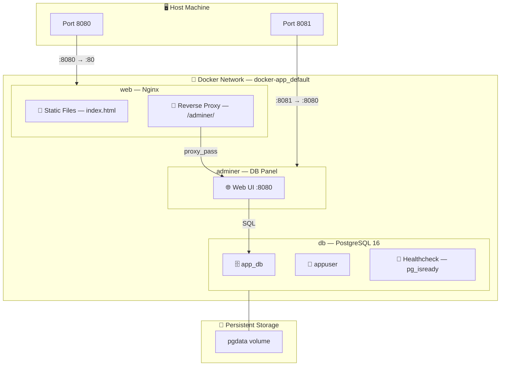

Task 15 — Containerized Application

## არქიტექტურა


## პროექტის სტრუქტურა:

```bash
mkdir -p ~/docker-app/nginx
cd ~/docker-app
```

### საბოლოო სტრუქტურა ასე გამოიყურება:

```
docker-app/
├── docker-compose.yml        # სერვისების აღწერა 
└── nginx/
    ├── nginx.conf            # Nginx კონფიგურაცია
    └── index.html            # Web გვერდი
```

## Docker Compose კონფიგურაცია

ეს არის მთავარი ფაილი, რომელიც სამივე სერვისს აღწერს და მათ შორის კავშირს ადგენს.


```bash
nano ~/docker-app/docker-compose.yml
```

```yaml
services:
  web:
    image: nginx:alpine
    ports:
      - "8080:80"
    volumes:
      - ./nginx/index.html:/usr/share/nginx/html/index.html:ro
      - ./nginx/nginx.conf:/etc/nginx/conf.d/default.conf:ro
    depends_on:
      db:
        condition: service_healthy
    restart: unless-stopped

  db:
    image: postgres:16-alpine
    environment:
      POSTGRES_DB: app_db
      POSTGRES_USER: appuser
      POSTGRES_PASSWORD: securepass123
    volumes:
      - pgdata:/var/lib/postgresql/data
    healthcheck:
      test: ["CMD-SHELL", "pg_isready -U appuser -d app_db"]
      interval: 5s
      timeout: 3s
      retries: 5
    restart: unless-stopped

  adminer:
    image: adminer:latest
    ports:
      - "8081:8080"
    depends_on:
      - db
    restart: unless-stopped

volumes:
  pgdata:
```

## სერვისების განმარტება

### Nginx Web Server კონფიგურაცია


| პარამეტრი | მნიშვნელობა |
|-----------|-------------|
| `image: nginx:alpine` | მსუბუქი Nginx image (~40MB Alpine Linux-ზე) |
| `ports: "8080:80"` | ჰოსტის 8080 პორტს აკავშირებს კონტეინერის 80-თან |
| `volumes: ...index.html:ro` | ლოკალურ ფაილს mount-ავს კონტეინერში (read-only) |
| `depends_on: db: condition: service_healthy` | ელოდება სანამ DB healthcheck-ს გაივლის |
| `restart: unless-stopped` | ავტომატურად გადაიტვირთება crash-ის შემთხვევაში |


#### `db` — PostgreSQL Database

| პარამეტრი | მნიშვნელობა |
|-----------|-------------|
| `image: postgres:16-alpine` | PostgreSQL 16 Alpine-ზე |
| `environment` | ბაზის სახელი, მომხმარებელი, პაროლი |
| `volumes: pgdata:/var/lib/...` | Named volume — მონაცემები შენარჩუნდება კონტეინერის წაშლის შემდეგაც |
| `healthcheck` | `pg_isready` ბრძანებით ამოწმებს მზადყოფნას ყოველ 5 წამში |

#### `adminer` — Database Management UI

| პარამეტრი | მნიშვნელობა |
|-----------|-------------|
| `image: adminer:latest` | ვებ-ინტერფეისი DB მართვისთვის |
| `ports: "8081:8080"` | ჰოსტის 8081 → კონტეინერის 8080 |
| `depends_on: db` | DB-ს შემდეგ ეშვება (healthcheck-ის გარეშე) |

#### `volumes: pgdata`

Named volume-ი უზრუნველყოფს რომ PostgreSQL-ის მონაცემები არ დაიკარგება `docker compose down`-ის შემდეგ. მონაცემები მხოლოდ `docker volume rm`-ით იშლება.

---

```bash
nano ~/docker-app/nginx/nginx.conf
```

```nginx
server {
    listen 80;
    server_name localhost;

    location / {
        root /usr/share/nginx/html;
        index index.html;
    }

    location /adminer/ {
        proxy_pass http://adminer:8080/;
        proxy_set_header Host $host;
        proxy_set_header X-Real-IP $remote_addr;
    }
}
```

## Location
რას აკეთებს თითოეული `location` ბლოკი:

- **`/`** — მთავარი გვერდი, ჩვენი `index.html` ფაილიდან
- **`/adminer/`** — მოთხოვნას გადამისამართებს Adminer-ის კონტეინერზე. Docker-ის შიდა DNS-ის წყალობით, `adminer` სახელი ავტომატურად resolve-დება სწორ IP-ზე

> 💡 `proxy_set_header` ჰედერები აუცილებელია — Adminer-მა იცოდეს კლიენტის რეალური IP მისამართი და hostname.


## Web გვერდი 

### database სტატუსი

```bash
nano ~/docker-app/nginx/index.html
```

```html
<!DOCTYPE html>
<html lang="ka">
<head>
    <meta charset="UTF-8">
    <meta name="viewport" content="width=device-width, initial-scale=1.0">
    <title>Docker App</title>
    <style>
        * { margin: 0; padding: 0; box-sizing: border-box; }
        body {
            font-family: 'Segoe UI', sans-serif;
            background: #0f172a;
            color: #e2e8f0;
            min-height: 100vh;
            display: flex;
            align-items: center;
            justify-content: center;
        }
        .card {
            background: #1e293b;
            border-radius: 16px;
            padding: 2.5rem;
            max-width: 500px;
            width: 90%;
            box-shadow: 0 20px 60px rgba(0,0,0,0.5);
            text-align: center;
        }
        h1 { font-size: 1.8rem; margin-bottom: 0.5rem; }
        .emoji { font-size: 3rem; margin-bottom: 1rem; }
        .services {
            margin: 1.5rem 0;
            text-align: left;
        }
        .service {
            display: flex;
            align-items: center;
            gap: 0.75rem;
            padding: 0.8rem 1rem;
            margin: 0.5rem 0;
            background: #0f172a;
            border-radius: 10px;
        }
        .dot {
            width: 12px; height: 12px;
            background: #22c55e;
            border-radius: 50%;
            box-shadow: 0 0 8px rgba(34,197,94,0.5);
        }
        .btn {
            display: inline-block;
            margin-top: 1.5rem;
            padding: 0.7rem 1.5rem;
            background: #3b82f6;
            color: #fff;
            text-decoration: none;
            border-radius: 10px;
            font-weight: 600;
            transition: background 0.2s;
        }
        .btn:hover { background: #2563eb; }
        .footer { margin-top: 1.5rem; font-size: 0.8rem; color: #64748b; }
    </style>
</head>
<body>
    <div class="card">
        <div class="emoji">🐳</div>
        <h1>Docker App Running!</h1>
        <p>Nginx + PostgreSQL + Adminer</p>

        <div class="services">
            <div class="service">
                <div class="dot"></div>
                <span><strong>Nginx</strong> — Web Server (port 8080)</span>
            </div>
            <div class="service">
                <div class="dot"></div>
                <span><strong>PostgreSQL 16</strong> — Database</span>
            </div>
            <div class="service">
                <div class="dot"></div>
                <span><strong>Adminer</strong> — DB Management</span>
            </div>
        </div>

        <a href="/adminer/" class="btn">Open Adminer (DB Panel)</a>

        <div class="footer">
            Task 15 — Containerized Application ✅
        </div>
    </div>
</body>
</html>

```

## აპლიკაციის გაშვება

```bash
cd ~/docker-app
docker compose up -d
```


`-d` ფლაგი (detached) სერვისებს background-ში უშვებს.

```console
k@devserver:~$ mkdir -p ~/docker-app/nginx
k@devserver:~$ cd ~/docker-app
k@devserver:~/docker-app$ nano ~/docker-app/docker-compose.yml
k@devserver:~/docker-app$ nano ~/docker-app/nginx/nginx.conf
k@devserver:~/docker-app$ nano ~/docker-app/nginx/index.html
k@devserver:~/docker-app$ cd ~/docker-app
k@devserver:~/docker-app$ docker compose up -d
[+] up 46/47
 ✔ Image adminer:latest           Pulled                                                                                                                                                           93.2ss
 ✔ Image postgres:16-alpine       Pulled                                                                                                                                                           134.1s
 ✔ Image nginx:alpine             Pulled                                                                                                                                                           78.5ss
 ✔ Network docker-app_default     Created                                                                                                                                                          0.4s
 ✔ Volume docker-app_pgdata       Created                                                                                                                                                          0.0s
 ✔ Container docker-app-db-1      Healthy                                                                                                                                                          16.7s
 ✔ Container docker-app-adminer-1 Created                                                                                                                                                          1.7s
 ✔ Container docker-app-web-1     Created                                                                                                                                                          1.7s
k@devserver:~/docker-app$
```


## სტატუსის შემოწმება
```bash
docker compose ps
```

```console
k@devserver:~/docker-app$ docker compose ps
NAME                   IMAGE                COMMAND                  SERVICE   CREATED         STATUS                   PORTS
docker-app-adminer-1   adminer:latest       "entrypoint.sh docke…"   adminer   4 minutes ago   Up 4 minutes             0.0.0.0:8081->8080/tcp, [::]:8081->8080/tcp
docker-app-db-1        postgres:16-alpine   "docker-entrypoint.s…"   db        4 minutes ago   Up 4 minutes (healthy)   5432/tcp
docker-app-web-1       nginx:alpine         "/docker-entrypoint.…"   web       4 minutes ago   Up 3 minutes             0.0.0.0:8080->80/tcp, [::]:8080->80/tcp
k@devserver:~/docker-app$
```

> ✅ სამივე სერვისი `Up` სტატუსშია, PostgreSQL-ს `(healthy)` აწერია — healthcheck წარმატებით გავიდა.


## ბრაუზერში წვდომა

| რა | მისამართი |
|----|-----------|
| Web გვერდი | `http://192.168.56.101:8080` |
| Adminer (პირდაპირ) | `http://192.168.56.101:8081` |
| Adminer (Nginx proxy-ით) | `http://192.168.56.101:8080/adminer/` |


### Adminer-ში შესვლა

Adminer-ის ფორმაში შემდეგი მონაცემები შეიყვანეთ:

| ველი | მნიშვნელობა |
|------|-------------|
| System | PostgreSQL |
| Server | `db` |
| Username | `appuser` |
| Password | `securepass123` |
| Database | `app_db` |

> 💡 Server ველში `db` ვწერთ და არა IP-ს — Docker Compose-ის შიდა ქსელში სერვისები ერთმანეთს სახელით პოულობენ.


## ხშირად გამოყენებული ბრძანებები

```bash
# სერვისების გაშვება (background-ში)
docker compose up -d
```
```bash
# სტატუსის ნახვა
docker compose ps
```
```bash
# ლოგების ნახვა (ყველა სერვისის)
docker compose logs
```
```bash
# კონკრეტული სერვისის ლოგები (real-time)
docker compose logs -f db
```
```bash
# სერვისების გაჩერება (კონტეინერების წაშლა, volume რჩება)
docker compose down
```
```bash
# სერვისების გაჩერება + volume-ების წაშლა (მონაცემები დაიკარგება!)
docker compose down -v
```

```console
k@devserver:~/docker-app$ docker compose logs
web-1  | /docker-entrypoint.sh: /docker-entrypoint.d/ is not empty, will attempt to perform configuration
adminer-1  | [Tue Feb 10 19:11:29 2026] PHP 8.4.17 Development Server (http://[::]:8080) started
adminer-1  | [Tue Feb 10 19:17:15 2026] [::ffff:172.18.0.4]:48620 Accepted
adminer-1  | [Tue Feb 10 19:17:15 2026] [::ffff:172.18.0.4]:48620 [200]: GET /
adminer-1  | [Tue Feb 10 19:17:15 2026] [::ffff:172.18.0.4]:48620 Closing
adminer-1  | [Tue Feb 10 19:17:15 2026] [::ffff:172.18.0.4]:48634 Accepted
adminer-1  | [Tue Feb 10 19:17:15 2026] [::ffff:172.18.0.4]:48634 [200]: GET /?file=default.css&version=5.4.2
adminer-1  | [Tue Feb 10 19:17:15 2026] [::ffff:172.18.0.4]:48634 Closing
adminer-1  | [Tue Feb 10 19:17:15 2026] [::ffff:172.18.0.4]:48636 Accepted
adminer-1  | [Tue Feb 10 19:17:15 2026] [::ffff:172.18.0.4]:48636 [200]: GET /?file=functions.js&version=5.4.2
adminer-1  | [Tue Feb 10 19:17:15 2026] [::ffff:172.18.0.4]:48636 Closing
adminer-1  | [Tue Feb 10 19:17:15 2026] [::ffff:172.18.0.4]:48656 Accepted
adminer-1  | [Tue Feb 10 19:17:15 2026] [::ffff:172.18.0.4]:48646 Accepted
web-1      | /docker-entrypoint.sh: Looking for shell scripts in /docker-entrypoint.d/
web-1      | /docker-entrypoint.sh: Launching /docker-entrypoint.d/10-listen-on-ipv6-by-default.sh
web-1      | 10-listen-on-ipv6-by-default.sh: info: can not modify /etc/nginx/conf.d/default.conf (read-only file system?)
web-1      | /docker-entrypoint.sh: Sourcing /docker-entrypoint.d/15-local-resolvers.envsh
web-1      | /docker-entrypoint.sh: Launching /docker-entrypoint.d/20-envsubst-on-templates.sh
web-1      | /docker-entrypoint.sh: Launching /docker-entrypoint.d/30-tune-worker-processes.sh
web-1      | /docker-entrypoint.sh: Configuration complete; ready for start up
web-1      | 2026/02/10 19:11:40 [notice] 1#1: using the "epoll" event method
web-1      | 2026/02/10 19:11:40 [notice] 1#1: nginx/1.29.5
web-1      | 2026/02/10 19:11:40 [notice] 1#1: built by gcc 15.2.0 (Alpine 15.2.0)
web-1      | 2026/02/10 19:11:40 [notice] 1#1: OS: Linux 6.8.0-100-generic
web-1      | 2026/02/10 19:11:40 [notice] 1#1: getrlimit(RLIMIT_NOFILE): 1024:524288
web-1      | 2026/02/10 19:11:40 [notice] 1#1: start worker processes
web-1      | 2026/02/10 19:11:40 [notice] 1#1: start worker process 21
web-1      | 2026/02/10 19:11:40 [notice] 1#1: start worker process 22
web-1      | 2026/02/10 19:11:40 [notice] 1#1: start worker process 23
web-1      | 2026/02/10 19:11:40 [notice] 1#1: start worker process 24
web-1      | 192.168.56.1 - - [10/Feb/2026:19:17:06 +0000] "GET / HTTP/1.1" 200 2758 "-" "Mozilla/5.0 (Windows NT 10.0; Win64; x64) AppleWebKit/537.36 (KHTML, like Gecko) Chrome/144.0.0.0 Safari/537.36" "-"
web-1      | 192.168.56.1 - - [10/Feb/2026:19:17:07 +0000] "GET /favicon.ico HTTP/1.1" 404 555 "http://192.168.56.101:8080/" "Mozilla/5.0 (Windows NT 10.0; Win64; x64) AppleWebKit/537.36 (KHTML, like Gecko) Chrome/144.0.0.0 Safari/537.36" "-"
web-1      | 2026/02/10 19:17:07 [error] 21#21: *1 open() "/usr/share/nginx/html/favicon.ico" failed (2: No such file or directory), client: 192.168.56.1, server: localhost, request: "GET /favicon.ico HTTP/1.1", host: "192.168.56.101:8080", referrer: "http://192.168.56.101:8080/"
db-1       | The files belonging to this database system will be owned by user "postgres".
adminer-1  | [Tue Feb 10 19:17:15 2026] [::ffff:172.18.0.4]:48656 [200]: GET /?file=dark.css&version=5.4.2
adminer-1  | [Tue Feb 10 19:17:15 2026] [::ffff:172.18.0.4]:48656 Closing
adminer-1  | [Tue Feb 10 19:17:15 2026] [::ffff:172.18.0.4]:48646 [200]: GET /?file=logo.png&version=5.4.2
adminer-1  | [Tue Feb 10 19:17:15 2026] [::ffff:172.18.0.4]:48646 Closing
adminer-1  | [Tue Feb 10 19:18:05 2026] [::ffff:192.168.56.1]:64530 Accepted
adminer-1  | [Tue Feb 10 19:18:05 2026] [::ffff:192.168.56.1]:64530 [200]: GET /
adminer-1  | [Tue Feb 10 19:18:05 2026] [::ffff:192.168.56.1]:64530 Closing
adminer-1  | [Tue Feb 10 19:18:05 2026] [::ffff:192.168.56.1]:58510 Accepted
adminer-1  | [Tue Feb 10 19:18:05 2026] [::ffff:192.168.56.1]:52270 Accepted
adminer-1  | [Tue Feb 10 19:18:05 2026] [::ffff:192.168.56.1]:58510 [200]: GET /?file=default.css&version=5.4.2
adminer-1  | [Tue Feb 10 19:18:05 2026] [::ffff:192.168.56.1]:58510 Closing
adminer-1  | [Tue Feb 10 19:18:05 2026] [::ffff:192.168.56.1]:52270 [200]: GET /?file=functions.js&version=5.4.2
adminer-1  | [Tue Feb 10 19:18:05 2026] [::ffff:192.168.56.1]:52270 Closing
adminer-1  | [Tue Feb 10 19:18:06 2026] [::ffff:192.168.56.1]:50365 Accepted
adminer-1  | [Tue Feb 10 19:18:06 2026] [::ffff:192.168.56.1]:50365 [200]: GET /?file=logo.png&version=5.4.2
adminer-1  | [Tue Feb 10 19:18:06 2026] [::ffff:192.168.56.1]:50365 Closing
adminer-1  | [Tue Feb 10 19:18:06 2026] [::ffff:192.168.56.1]:59937 Accepted
adminer-1  | [Tue Feb 10 19:18:06 2026] [::ffff:192.168.56.1]:59937 [200]: GET /?file=dark.css&version=5.4.2
adminer-1  | [Tue Feb 10 19:18:06 2026] [::ffff:192.168.56.1]:59937 Closing
adminer-1  | [Tue Feb 10 19:18:40 2026] [::ffff:192.168.56.1]:60589 Accepted
adminer-1  | [Tue Feb 10 19:18:40 2026] [::ffff:192.168.56.1]:60589 [302]: POST /
adminer-1  | [Tue Feb 10 19:18:40 2026] [::ffff:192.168.56.1]:60589 Closing
adminer-1  | [Tue Feb 10 19:18:40 2026] [::ffff:192.168.56.1]:55250 Accepted
adminer-1  | [Tue Feb 10 19:18:40 2026] [::ffff:192.168.56.1]:55250 [403]: GET /?server=db&username=appuser&db=app_db
adminer-1  | [Tue Feb 10 19:18:40 2026] [::ffff:192.168.56.1]:55250 Closing
adminer-1  | [Tue Feb 10 19:18:51 2026] [::ffff:192.168.56.1]:58682 Accepted
adminer-1  | [Tue Feb 10 19:18:51 2026] [::ffff:192.168.56.1]:58682 [302]: POST /?server=db&username=appuser&db=app_db
adminer-1  | [Tue Feb 10 19:18:51 2026] [::ffff:192.168.56.1]:58682 Closing
adminer-1  | [Tue Feb 10 19:18:51 2026] [::ffff:192.168.56.1]:58589 Accepted
adminer-1  | [Tue Feb 10 19:18:51 2026] [::ffff:192.168.56.1]:58589 [302]: GET /?pgsql=db&username=appuser&db=app_db
adminer-1  | [Tue Feb 10 19:18:51 2026] [::ffff:192.168.56.1]:58589 Closing
adminer-1  | [Tue Feb 10 19:18:51 2026] [::ffff:192.168.56.1]:63223 Accepted
adminer-1  | [Tue Feb 10 19:18:51 2026] [::ffff:192.168.56.1]:63223 [200]: GET /?pgsql=db&username=appuser&db=app_db&ns=public
adminer-1  | [Tue Feb 10 19:18:51 2026] [::ffff:192.168.56.1]:63223 Closing
adminer-1  | [Tue Feb 10 19:18:51 2026] [::ffff:192.168.56.1]:65136 Accepted
adminer-1  | [Tue Feb 10 19:18:51 2026] [::ffff:192.168.56.1]:65136 [200]: GET /?file=jush.js&version=5.4.2
adminer-1  | [Tue Feb 10 19:18:51 2026] [::ffff:192.168.56.1]:65136 Closing
web-1      | 192.168.56.1 - - [10/Feb/2026:19:17:15 +0000] "GET /adminer/ HTTP/1.1" 200 2319 "http://192.168.56.101:8080/" "Mozilla/5.0 (Windows NT 10.0; Win64; x64) AppleWebKit/537.36 (KHTML, like Gecko) Chrome/144.0.0.0 Safari/537.36" "-"
web-1      | 192.168.56.1 - - [10/Feb/2026:19:17:15 +0000] "GET /adminer/?file=default.css&version=5.4.2 HTTP/1.1" 200 3040 "http://192.168.56.101:8080/adminer/" "Mozilla/5.0 (Windows NT 10.0; Win64; x64) AppleWebKit/537.36 (KHTML, like Gecko) Chrome/144.0.0.0 Safari/537.36" "-"
web-1      | 192.168.56.1 - - [10/Feb/2026:19:17:15 +0000] "GET /adminer/?file=functions.js&version=5.4.2 HTTP/1.1" 200 8710 "http://192.168.56.101:8080/adminer/" "Mozilla/5.0 (Windows NT 10.0; Win64; x64) AppleWebKit/537.36 (KHTML, like Gecko) Chrome/144.0.0.0 Safari/537.36" "-"
web-1      | 192.168.56.1 - - [10/Feb/2026:19:17:15 +0000] "GET /adminer/?file=logo.png&version=5.4.2 HTTP/1.1" 200 622 "http://192.168.56.101:8080/adminer/" "Mozilla/5.0 (Windows NT 10.0; Win64; x64) AppleWebKit/537.36 (KHTML, like Gecko) Chrome/144.0.0.0 Safari/537.36" "-"
web-1      | 192.168.56.1 - - [10/Feb/2026:19:17:15 +0000] "GET /adminer/?file=dark.css&version=5.4.2 HTTP/1.1" 200 769 "http://192.168.56.101:8080/adminer/" "Mozilla/5.0 (Windows NT 10.0; Win64; x64) AppleWebKit/537.36 (KHTML, like Gecko) Chrome/144.0.0.0 Safari/537.36" "-"
db-1       | This user must also own the server process.
db-1       |
db-1       | The database cluster will be initialized with locale "en_US.utf8".
db-1       | The default database encoding has accordingly been set to "UTF8".
db-1       | The default text search configuration will be set to "english".
db-1       |
db-1       | Data page checksums are disabled.
db-1       |
db-1       | fixing permissions on existing directory /var/lib/postgresql/data ... ok
db-1       | creating subdirectories ... ok
db-1       | selecting dynamic shared memory implementation ... posix
db-1       | selecting default max_connections ... 100
db-1       | selecting default shared_buffers ... 128MB
db-1       | selecting default time zone ... UTC
db-1       | creating configuration files ... ok
db-1       | running bootstrap script ... ok
db-1       | sh: locale: not found
db-1       | 2026-02-10 19:11:31.906 UTC [36] WARNING:  no usable system locales were found
db-1       | performing post-bootstrap initialization ... ok
db-1       | initdb: warning: enabling "trust" authentication for local connections
db-1       | initdb: hint: You can change this by editing pg_hba.conf or using the option -A, or --auth-local and --auth-host, the next time you run initdb.
db-1       | syncing data to disk ... ok
db-1       |
db-1       |
db-1       | Success. You can now start the database server using:
db-1       |
db-1       |     pg_ctl -D /var/lib/postgresql/data -l logfile start
db-1       |
db-1       | waiting for server to start....2026-02-10 19:11:36.629 UTC [48] LOG:  starting PostgreSQL 16.11 on x86_64-pc-linux-musl, compiled by gcc (Alpine 15.2.0) 15.2.0, 64-bit
db-1       | 2026-02-10 19:11:36.648 UTC [48] LOG:  listening on Unix socket "/var/run/postgresql/.s.PGSQL.5432"
db-1       | 2026-02-10 19:11:36.685 UTC [51] LOG:  database system was shut down at 2026-02-10 19:11:34 UTC
db-1       | 2026-02-10 19:11:36.725 UTC [48] LOG:  database system is ready to accept connections
db-1       |  done
db-1       | server started
db-1       | CREATE DATABASE
db-1       |
db-1       |
db-1       | /usr/local/bin/docker-entrypoint.sh: ignoring /docker-entrypoint-initdb.d/*
db-1       |
db-1       | waiting for server to shut down....2026-02-10 19:11:37.164 UTC [48] LOG:  received fast shutdown request
db-1       | 2026-02-10 19:11:37.194 UTC [48] LOG:  aborting any active transactions
db-1       | 2026-02-10 19:11:37.206 UTC [48] LOG:  background worker "logical replication launcher" (PID 54) exited with exit code 1
db-1       | 2026-02-10 19:11:37.224 UTC [49] LOG:  shutting down
db-1       | 2026-02-10 19:11:37.249 UTC [49] LOG:  checkpoint starting: shutdown immediate
db-1       | 2026-02-10 19:11:38.116 UTC [49] LOG:  checkpoint complete: wrote 926 buffers (5.7%); 0 WAL file(s) added, 0 removed, 0 recycled; write=0.153 s, sync=0.656 s, total=0.891 s; sync files=301, longest=0.025 s, average=0.003 s; distance=4272 kB, estimate=4272 kB; lsn=0/191E918, redo lsn=0/191E918
db-1       | 2026-02-10 19:11:38.137 UTC [48] LOG:  database system is shut down
db-1       |  done
db-1       | server stopped
db-1       |
db-1       | PostgreSQL init process complete; ready for start up.
db-1       |
db-1       | 2026-02-10 19:11:38.274 UTC [1] LOG:  starting PostgreSQL 16.11 on x86_64-pc-linux-musl, compiled by gcc (Alpine 15.2.0) 15.2.0, 64-bit
db-1       | 2026-02-10 19:11:38.279 UTC [1] LOG:  listening on IPv4 address "0.0.0.0", port 5432
db-1       | 2026-02-10 19:11:38.280 UTC [1] LOG:  listening on IPv6 address "::", port 5432
db-1       | 2026-02-10 19:11:38.326 UTC [1] LOG:  listening on Unix socket "/var/run/postgresql/.s.PGSQL.5432"
db-1       | 2026-02-10 19:11:38.385 UTC [64] LOG:  database system was shut down at 2026-02-10 19:11:38 UTC
db-1       | 2026-02-10 19:11:38.420 UTC [1] LOG:  database system is ready to accept connections
db-1       | 2026-02-10 19:16:38.483 UTC [62] LOG:  checkpoint starting: time
db-1       | 2026-02-10 19:16:41.469 UTC [62] LOG:  checkpoint complete: wrote 31 buffers (0.2%); 0 WAL file(s) added, 0 removed, 0 recycled; write=2.875 s, sync=0.047 s, total=2.987 s; sync files=11, longest=0.023 s, average=0.005 s; distance=139 kB, estimate=139 kB; lsn=0/19418F0, redo lsn=0/19418B8
k@devserver:~/docker-app$

```

---

## განახლებული ვერსია: უსაფრთხო კონფიგურაცია და რატომ ვაკეთებთ ასე
იგივე აპლიკაცია ახალ VM-ზე (`myubuntuserver`, `192.168.56.10`), ოდნავ გაუმჯობესებული უსაფრთხოებით. ქვემოთ ნათქვამია არა მხოლოდ **რა** გავაკეთეთ, არამედ **რატომ**. <br>

### რას ვაშენებთ
ერთი აპლიკაცია სამი ცალკე კონტეინერისგან, რომლებიც ერთ შიდა ქსელში მუშაობენ: <br>
- **web** (Nginx) — მომხმარებელს ვებ-გვერდს აჩვენებს და `/adminer/`-ზე მოთხოვნებს გადასცემს Adminer-ს (reverse proxy)
- **db** (PostgreSQL 16) — მონაცემთა ბაზა
- **adminer** — ბაზის სამართავი ვებ-პანელი

მთელი აპლიკაცია ერთი ფაილით (`docker-compose.yml`) და ერთი ბრძანებით (`docker compose up -d`) გაიშვება. ეს არის Docker Compose-ის მთავარი ღირებულება: ინფრასტრუქტურა კოდად დაწერილია და ნებისმიერ სერვერზე ერთნაირად აღდგება.

### 1. პაროლი `.env` ფაილში და არა `docker-compose.yml`-ში
```bash
nano ~/docker-app/.env
```
```text
DB_PASSWORD=ჩაწერე_რთული_პაროლი
```
```bash
chmod 600 ~/docker-app/.env
```
**რატომ:**
- `docker-compose.yml` ხშირად git-ში იდება და სხვებსაც უჩვენებენ. თუ პაროლი მასშია, ის გამჟღავნდება
- `.env` ცალკე ფაილია, რომელიც git-ში **არასოდეს** იდება (დაამატე `.gitignore`-ში)
- `chmod 600` ნიშნავს, რომ ფაილს მხოლოდ შენ კითხულობ
- Docker Compose `.env`-ს ავტომატურად კითხულობს და `${DB_PASSWORD}` ცვლადს მნიშვნელობას ანიჭებს

### 2. `docker-compose.yml`
```yaml
services:
  web:
    image: nginx:alpine
    ports:
      - "8080:80"
    volumes:
      - ./nginx/index.html:/usr/share/nginx/html/index.html:ro
      - ./nginx/nginx.conf:/etc/nginx/conf.d/default.conf:ro
    depends_on:
      db:
        condition: service_healthy
    restart: unless-stopped

  db:
    image: postgres:16-alpine
    environment:
      POSTGRES_DB: app_db
      POSTGRES_USER: appuser
      POSTGRES_PASSWORD: ${DB_PASSWORD}
    volumes:
      - pgdata:/var/lib/postgresql/data
    healthcheck:
      test: ["CMD-SHELL", "pg_isready -U appuser -d app_db"]
      interval: 5s
      timeout: 3s
      retries: 5
    restart: unless-stopped

  adminer:
    image: adminer:latest
    depends_on:
      - db
    restart: unless-stopped

volumes:
  pgdata:
```

### რატომ არის თითოეული გადაწყვეტილება
| გადაწყვეტილება | რატომ |
|----------------|-------|
| `ports: "8080:80"` (web) | VM-ზე ჩვეულებრივი Nginx (Task 8/9) უკვე 80-ე პორტს იყენებს. კონტეინერის Nginx-ს იმავე პორტზე ვერ გავუშვებთ და ამიტომ ჰოსტზე 8080-ს ვიყენებთ |
| `adminer`-ს `ports` არ აქვს | ბაზის პანელი გარედან პირდაპირ არ უნდა ჩანდეს. მასთან მხოლოდ Nginx-ის გავლით შეიძლება (`/adminer/`). ასე ერთი შესასვლელი გვაქვს და თავდასხმის ზედაპირი მცირდება |
| `db`-ს `ports` არ აქვს | PostgreSQL მხოლოდ Docker-ის შიდა ქსელშია (`5432/tcp`). ბაზა გარედან მიუწვდომელია, მასთან მხოლოდ სხვა კონტეინერები ახერხებენ დაკავშირებას |
| `healthcheck` + `condition: service_healthy` | `web` ელოდება, სანამ ბაზა მზად იქნება (`pg_isready`). `depends_on` მარტო კონტეინერის გაშვებას ამოწმებს და არა იმას, რომ PostgreSQL უკვე იღებს კავშირებს |
| `volumes: pgdata` (named volume) | ბაზის მონაცემები კონტეინერის გარეთ ინახება. `docker compose down`-ის შემდეგაც არ იკარგება. წასაშლელად საჭიროა ცალკე `docker volume rm` |
| `:ro` (read-only) mount-ები | Nginx-ის კონტეინერს ფაილების შეცვლა არ შეუძლია. თუ კონტეინერი გატეხილია, თავდამსხმელი ვერ შეცვლის კონფიგურაციას ან გვერდს |
| `restart: unless-stopped` | კონტეინერი crash-ის ან VM-ის გადატვირთვის შემდეგ ავტომატურად ჩაირთვება, თუ ხელით არ გაგიჩერებია |
| `${DB_PASSWORD}` | პაროლი `.env`-იდან, იხილე ზემოთ |
| `nginx:alpine`, `postgres:16-alpine` | Alpine-ზე დაფუძნებული image-ები უფრო მცირეა (ნაკლები ადგილი, ნაკლები დაუცველობა) |
| სერვისების სახელები (`db`, `adminer`) | Docker-ის შიდა DNS სახელს თავად გადაწყვეტს. Nginx-ში `proxy_pass http://adminer:8080/`, Adminer-ში Server = `db`. IP-ებს არ ვიმახსოვრებთ |

### 3. გაშვება
```bash
cd ~/docker-app
```
```bash
docker compose up -d
```
```console
k@myubuntuserver:~/docker-app$ docker compose up -d
[+] Running 42/42
 ✔ adminer Pulled                                                                                20.5s
 ✔ web Pulled                                                                                    13.0s
 ✔ db Pulled                                                                                     31.9s
[+] Running 5/5
 ✔ Network docker-app_default      Created                                                        0.2s
 ✔ Volume docker-app_pgdata        Created                                                        0.0s
 ✔ Container docker-app-db-1       Healthy                                                       32.0s
 ✔ Container docker-app-adminer-1  Started                                                       13.8s
 ✔ Container docker-app-web-1      Started                                                       29.8s
```
`Container docker-app-db-1 Healthy` ჯერ ბაზა გახდა მზად, მხოლოდ ამის შემდეგ დაიწყო `web`. ეს `service_healthy`-ის მუშაობაა. <br>

### 4. სტატუსი და პორტები
```bash
docker compose ps
```
```console
NAME                   IMAGE                COMMAND                  SERVICE   CREATED          STATUS                    PORTS
docker-app-adminer-1   adminer:latest       "entrypoint.sh docke…"   adminer   35 seconds ago   Up 25 seconds             8080/tcp
docker-app-db-1        postgres:16-alpine   "docker-entrypoint.s…"   db        37 seconds ago   Up 28 seconds (healthy)   5432/tcp
docker-app-web-1       nginx:alpine         "/docker-entrypoint.…"   web       35 seconds ago   Up 5 seconds              0.0.0.0:8080->80/tcp, [::]:8080->80/tcp
```
`PORTS` სვეტი ზუსტად ადასტურებს ზემოთ ნათქვამს: <br>
- `web` — `0.0.0.0:8080->80/tcp`: ერთადერთი სერვისი, რომელიც გარედან ჩანს
- `adminer` — მხოლოდ `8080/tcp` (შიდა), გარეთ არ არის გამოტანილი
- `db` — მხოლოდ `5432/tcp` (შიდა), გარეთ არ არის გამოტანილი
- `db`-ს აწერია `(healthy)` — healthcheck წარმატებით გავიდა

### 5. შედეგის შემოწმება
VM-ში: <br>
```bash
curl -I http://localhost:8080
```
```console
HTTP/1.1 200 OK
Server: nginx/1.31.8
Date: Tue, 10 Nov 2026 14:05:37 GMT
Content-Type: text/html
Content-Length: 599
```
host-იდან შემოწმებისას: <br>
```bash
curl -s -o /dev/null -w "%{http_code}\n" http://192.168.56.10:8080/
```
```bash
curl -s -o /dev/null -w "%{http_code}\n" http://192.168.56.10:8080/adminer/
```
ორივე `200`-ს აბრუნებს (web გვერდი და Nginx-ის proxy-ით Adminer). უსაფრთხოების შესამოწმებლად, ძველი პირდაპირი Adminer-ის პორტი (8081) აღარ პასუხობს: <br>
```bash
curl -s -o /dev/null -w "%{http_code}\n" --max-time 3 http://192.168.56.10:8081/
```
შედეგი `000` (კავშირი არ არსებობს) — ანუ ბაზის პანელი პირდაპირ დახურულია. <br>

browser-ში: `http://192.168.56.10:8080` და `http://192.168.56.10:8080/adminer/`. Adminer-ის ფორმაში: System = PostgreSQL, **Server = `db`** (და არა IP), Username = `appuser`, Password = `.env`-ის პაროლი, Database = `app_db`. <br>

!!! warning "Docker და firewall (UFW)"
    Docker-ით გამოქვეყნებული პორტი (`8080`) UFW-ს წესებს გვერდს უვლის: `ufw status`-ში 8080 არ ჩანს, მაგრამ მაინც ღიაა. ჩვენი VM Host-Only ქსელშია, ამიტომ აქ ეს პრობლემა არ არის. რეალურ სერვერზე ეს უნდა გახსოვდეს და გამოსაქვეყნებელი პორტები შეგნებულად შეარჩიო (მაგალითად `127.0.0.1:8080:80`, თუ გარედან არ უნდა ჩანდეს).

### 6. Adminer-ში შესვლა
მისამართი (ფორმის წინასწარ შევსებით): <br>
```text
http://192.168.56.10:8080/adminer/?pgsql=db&username=appuser&db=app_db
```
`pgsql=db` ავსებს System/Server ველებს (PostgreSQL და `db`), `username` და `db` — იუზერსა და ბაზას. აგრძელებს მხოლოდ პაროლის შეყვანა (`.env`-ის `DB_PASSWORD`). შესვლა წარმატებით შესრულდა, ანუ აპლიკაციას ბაზასთან კავშირი აქვს. <br>

---

## ხშირი პრობლემები და მათი გადაჭრა
სამი შეცდომა, რომელიც ამ ამოცანის შესრულებისას მართლა შეგვხვდა. <br>

### პრობლემა 1: `no configuration file provided: not found`
```console
k@myubuntuserver:~$ docker compose up -d
no configuration file provided: not found
k@myubuntuserver:~$ docker compose ps
no configuration file provided: not found
```
**მიზეზი:** `docker compose` `docker-compose.yml`-ს **მიმდინარე საქაღალდეში** ეძებს. აქ `~`-ში (`/home/k`) ვიყავით, ფაილი კი `~/docker-app`-შია. <br>

**გამოსავალი:** გადადი პროექტის საქაღალდეში: <br>
```bash
cd ~/docker-app
```
```bash
docker compose ps
```
ან ფაილი პირდაპირ მიუთითე (ნებისმიერი საქაღალდიდან): <br>
```bash
docker compose -f ~/docker-app/docker-compose.yml ps
```

### პრობლემა 2: ბრაუზერში `http://192.168.56.101:8080/...` არ იხსნება
**მიზეზი:** `192.168.56.101` ძველი, **დინამიური (DHCP)** მისამართია. Task 3-ის შემდეგ VM-ს სტატიკური `192.168.56.10` აქვს და ძველი მისამართი აღარ არსებობს. ბრაუზერის ისტორია ან bookmark ძველ IP-ს ინახავს. <br>

**გამოსავალი:** გამოიყენე `http://192.168.56.10:8080/`. რომ დარწმუნდე, რომელი IP გაქვს: <br>
```bash
ip -4 a show enp0s8
```
host-იდან შემოწმება: <br>
```bash
curl -s -o /dev/null -w "%{http_code}\n" http://192.168.56.10:8080/adminer/
```
`200` ნიშნავს, რომ მისამართი სწორია. <br>

### პრობლემა 3: `password authentication failed for user "appuser"`
Adminer იხსნება, მაგრამ შესვლისას: <br>
```console
SQLSTATE[08006] [7] connection to server at "db" (172.18.0.3), port 5432 failed: FATAL: password authentication failed for user "appuser"
```
შეცდომის წაკითხვა მნიშვნელოვანია: `connection to server at "db" (172.18.0.3)` ნიშნავს, რომ ქსელი და კავშირი **მუშაობს** (Adminer ბაზამდე მივიდა), პრობლემა მხოლოდ **პაროლშია**. <br>

**მიზეზი:** PostgreSQL-ის image `POSTGRES_PASSWORD`-ს კითხულობს **მხოლოდ პირველი გაშვებისას**, როცა `pgdata` volume ცარიელია, და პაროლს ბაზის შიგნით ინახავს. თუ მოგვიანებით `.env`-ში პაროლი შეიცვალა, ბაზა ძველს ინარჩუნებს და ახალი პაროლი აღარ ემთხვევა. სხვა შესაძლო მიზეზებია: Adminer-ში პაროლი სხვანაირად ჩაიწერა, ან `.env` ხაზში ზედმეტი ინტერვალია. <br>

**შემოწმება:** `cat -A` ფაილს ფარული სიმბოლოებით აჩვენებს (`$` ხაზის ბოლოა): <br>
```bash
cd ~/docker-app
cat -A .env
```
ხაზი უნდა იყოს `DB_PASSWORD=პაროლი$`, ინტერვალებისა და `^M`-ის გარეშე. <br>

**გამოსავალი A: ბაზაში პაროლის `.env`-ს გაუთანაბრება (მონაცემები ინარჩუნებს)** <br>
```bash
docker compose exec -T db sh -c 'psql -U appuser -d app_db -v pw="$POSTGRES_PASSWORD"' <<< "ALTER USER appuser PASSWORD :'pw';"
```
```console
ALTER ROLE
```
კონტეინერი პაროლს საკუთარი გარემოდან კითხულობს (`$POSTGRES_PASSWORD`, რომელიც `.env`-იდან მოდის), ამიტომ პაროლი ბრძანებაში არ ჩანს და ტერმინალის ისტორიაში არ რჩება. <br>

**გამოსავალი B: ბაზის თავიდან შექმნა (ახალი, ცარიელი)** <br>
```bash
docker compose down -v
```
```bash
docker compose up -d
```
`-v` volume-ს შლის და ბაზის **ყველა მონაცემი იკარგება**. `up` ბაზას `.env`-ის მიმდინარე პაროლით ხელახლა შექმნის. გამოიყენე მხოლოდ მაშინ, თუ ბაზაში მნიშვნელოვანი არაფერი გაქვს. <br>

!!! tip "გაკვეთილი"
    `.env`-ში პაროლის შეცვლა **არსებულ** ბაზაზე არ მოქმედებს. გადაწყვიტე პაროლი **პირველ `docker compose up`-მდე**. თუ მაინც შესცვალე, გამოიყენე გამოსავალი A (მონაცემების შენარჩუნებით) ან B (ახლიდან დაწყება).

!!! info "როგორ ვკითხულობთ შეცდომებს"
    | შეცდომა | რას ნიშნავს |
    |---------|-------------|
    | `no configuration file provided` | `docker compose` არასწორ საქაღალდეშია გაშვებული |
    | ბრაუზერში გვერდი არ იხსნება | ქსელი/IP/პორტი: შეამოწმე მისამართი და `docker compose ps` |
    | `connection to server at "db" ... failed: password authentication` | ქსელი მუშაობს, პაროლი არ ემთხვევა |
    | `could not translate host name "db"` | `db` სერვისი არ მუშაობს ან სხვა ქსელშია |

